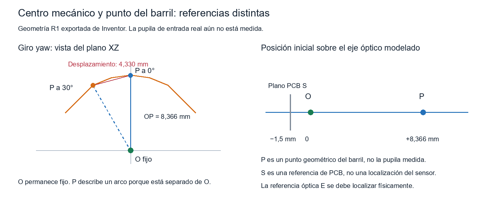

# Auditoría integral del gimbal: mecánica y centro de giro

Iniciada el 13 de noviembre y terminada el 14 de noviembre de 2026. Se revisó la
geometría recibida y la revisión R1, incorporando la aclaración de Alexander:
el cabezal del servo descargado es más grande que el del ejemplar físico y la
pieza seis procede de un diseño previamente analizado. Se conserva la pieza seis.
El diámetro real del estriado todavía no está medido.

## Resultado principal

**La cadena R1 mantiene un centro mecánico común al girar. Todavía no está
comprobado que ese centro coincida con el punto de vista óptico de la cámara.**
Además, el recorrido no puede declararse libre en todo el intervalo ensayado:
hay choques de carcasas/base en algunas combinaciones de giros grandes.

Abrir [CAD/Gimbal_auditoria_con_ejes.iam](CAD/Gimbal_auditoria_con_ejes.iam).
El conjunto se deja guardado en cero y contiene las referencias de medición.
R1 y los originales se conservan; no se modificó su geometría ni sus archivos CAD.

## 1. Qué centro interesa realmente

El origen de coordenadas se puede elegir donde resulte útil. Cambiar el origen
numérico no cambia el movimiento físico. Para el banco con una escena cercana,
lo que interesa es que el centro de perspectiva permanezca fijo durante el giro.

Se distinguen cuatro referencias:

| Referencia | Qué representa | Estado |
|---|---|---|
| O | Intersección de los tres ejes mecánicos; en R1: (10,15; 114,50; 0) mm | Comprobada en CAD |
| P | Punto geométrico sobre el eje del barril, a 8,3655 mm delante de O | Comprobado en CAD; no es una pupila medida |
| S | Intersección del eje con el plano de referencia de la PCB del modelo, 1,5 mm detrás de O | Referencia geométrica; no localiza el sensor real |
| E | Centro de la pupila de entrada del lente real, referencia para evitar paralaje | Pendiente de localización física |

El sensor es la superficie donde debe quedar enfocada la imagen. Su posición,
el foco de un sistema óptico y la pupila de entrada son conceptos diferentes.
La pupila de entrada es la imagen del diafragma vista desde el lado de la escena;
su centro es la referencia de perspectiva en el modelo de cámara central.
No se puede asignar E al frente del vidrio, al centro del barril, al sensor ni a
una posición tomada de una captura sin caracterizar el lente.

La referencia técnica empleada es [Littlefield, Theory of the No-Parallax Point](https://www.janrik.net/PanoPostings/NoParallaxPoint/TheoryOfTheNoParallaxPoint.pdf),
que presenta demostraciones ópticas y fotográficas. La definición de pupila se
contrasta con [Ansys/Zemax: Paraxial vs. Real pupils](https://optics.ansys.com/hc/en-us/articles/42661958583571-Paraxial-vs-Real-pupils-in-optical-system).
En un sistema real puede existir dependencia con campo/enfoque; la caracterización
se debe realizar en la configuración y región que utilizará el banco.

La conclusión anterior de R1 era de concurrencia mecánica y coaxialidad del
barril. **No debe interpretarse como demostración de ausencia de traslación
del centro óptico.** La distancia longitudinal O-E quedó sin determinar.

## 2. Qué se mueve y qué permanece fijo

Un sólido que gira alrededor de O desplaza todos sus puntos que no están en
el eje de ese giro. Ver moverse la PCB, una esquina o el frente del lente no
demuestra por sí solo una traslación parasitaria del centro de perspectiva.
También se moverán las estrellas sobre la imagen por la rotación esperada.

Para comparar se midieron O y P, usando las transformaciones resueltas por Inventor:

| Movimiento desde cero | Desplazamiento de O | Desplazamiento de P |
|---|---:|---:|
| Yaw 30 grados | Menor de 0,00001 mm | 4,3303 mm |
| Pitch 30 grados | Menor de 0,00001 mm | 4,3303 mm |
| Roll 30 grados | Menor de 0,00001 mm | Menor de 0,00001 mm |
| Yaw/pitch/roll 30 grados | Menor de 0,00001 mm | 5,9153 mm |

P está sobre el eje roll, por eso no recorre un arco al girar solo roll. Está
separado de los ejes yaw y pitch: al girar esos ejes recorre un arco de radio
8,3655 mm. Para un giro aislado, la cuerda es `d = 2 r sen(|ángulo|/2)`.
Los datos exportados coinciden con esa relación. Esta distancia de P **no es
una medición del error de E**, cuya posición no se conoce.

Con estrellas reales lejanas la traslación del banco tiene un efecto de paralaje
muy distinto al de una pantalla cercana. Para el banco de pantalla a distancia
finita se debe localizar E y hacer O = E, o incluir la posición variable de E en
la geometría de referencia y su presupuesto de incertidumbre.

## 3. Prueba de movimiento y colisiones

Se hicieron 22 pruebas individuales/combinadas y una malla de 125 combinaciones:
yaw, pitch y roll en {-60, -30, 0, 30, 60} grados. Se cambiaron parámetros de las
restricciones y se pidió al solver actualizar cada postura. No se limitaron a
mover piezas gráficamente ni a aplicar una cinemática ideal fuera del CAD.

- Las 125 combinaciones se resolvieron, sin restricciones fallidas.
- O se mantuvo fijo dentro de 0,00001 mm en todas ellas. La variación calculada
  máxima fue 2,565e-11 mm, exclusivamente ruido numérico; no precisión física.
- Los tres ejes siguieron pasando por O en las posturas medidas.
- En 20 de las 125 posturas hubo colisión entre el tercer servo y la base.
  En cinco de ellas también hubo colisión entre el tercer y el primer servo.
- En las 27 combinaciones con todos los comandos dentro de {-30, 0, 30} grados
  no aparecieron esos choques entre cuerpos. Esto no certifica el movimiento
  continuo entre muestras ni un límite físico seguro de ±30 grados.

Se comprobaron los cuerpos estructurales, incluidos base, soportes, discos,
carcasas de servos, portacámara, cámara y separador. En este barrido se excluyeron
los tornillos, y no hay cableado modelado. Solo se separaron como discrepancia
de cabezal los pares Servo MG996R:i/Pieza6:i del mismo eje. Los otros pares
se revisaron de manera independiente.

Ejemplo concreto: yaw = -60, pitch = -60, roll = 0 grados:

| Par | Volumen común | Zona de intersección |
|---|---:|---|
| Tercer servo / base | 604,10 mm³ | Y entre 36,02 y 42 mm; zona de carcasa posterior y parte alta de la base |
| Tercer servo / primer servo | 43,81 mm³ | Y entre 36,50 y 46,50 mm |

La [captura posterior](Choque_carcasa_base_yaw_m60_pitch_m60.jpg) muestra la
carcasa trasera del tercer servo invadiendo la base. Este caso no se elimina
simplemente suponiendo un estriado de menor diámetro. La comprobación sigue
dependiendo de las dimensiones exteriores reales de las carcasas.

La solución a definir es limitar el recorrido útil, elevar/separar etapas o
revisar la envolvente del soporte. No se ha realizado ese rediseño en esta auditoría.

## 4. Pieza seis y servo descargado

El modelo contiene una superficie cilíndrica de salida de radio 3,5920 mm,
diámetro 7,1840 mm. La pieza seis tiene un alojamiento nominal de 5,5 mm y
otras superficies centrales de retención. Esto explica la incompatibilidad
geométrica del cabezal descargado con ese alojamiento.

Alexander indica que el cabezal real es del tamaño del agujero o menor. Se
registra esa información como observación del usuario, sin convertirla en
una medida verificada. **No se agrandó el agujero ni se alteró la pieza seis
para adaptarla al modelo descargado.**

Pendientes del acople real: diámetro mayor del estriado, número/perfil de dientes,
altura de salida, profundidad de inserción, tornillo central compatible y juego.
Un diámetro exterior menor no demuestra por sí solo compatibilidad de estrías.

## 5. Revisión del resto del diseño

| Aspecto | Hallazgo | Clasificación / cierre |
|---|---|---|
| Geometría nativa | Base, soportes, discos y portacámara se actualizan; piezas propias de un sólido. La cámara importada tiene 27 cuerpos, admisibles para ese modelo | Correcto como geometría CAD; no valida resistencia |
| Centro mecánico | Concurrente y estable durante las muestras | Correcto en R1 ideal |
| Centro óptico | O-E desconocido | Pendiente crítico para el banco cercano |
| Recorrido | Choques entre carcasa posterior/base en combinaciones grandes | Problema confirmado en el CAD |
| Materiales | Las nueve piezas distintas inspeccionadas están asignadas a material «Genérico» | Masa, centro de gravedad e inercia automáticos no se pueden aceptar como valores físicos |
| Retención axial | El ensamblaje identifica 12 tornillos M3x10 y 16 M3x5; no aparecen tres tornillos centrales independientes para retener los discos en los ejes | Documentar el tornillo/acople real; no se afirma que falten físicamente |
| Separador R1 | Añade 0,8 mm al apilamiento del segundo acople | Verificar asiento y longitud/enganche de los tornillos reales |
| Rigidez | Soportes en voladizo y apoyo mediante salidas de servo; no se modelaron apoyos opuestos adicionales | Evaluar flecha, holgura y vibración; no hay ensayo ni FEA validada |
| Base al banco | No hay un montaje verificado a una mesa/plataforma rígida | Definir sujeción y comprobar que no deslice o vuelque |
| Cable de cámara | No está incluido en la envolvente ni en el modelo de cargas | Añadir recorrido libre y alivio de tracción; puede introducir par y limitar giros |
| Fabricación | Tolerancias generales ±0,01 mm/N6 del plano inicial no están justificadas para PETG impreso | Definir ajustes y tolerancias por función/proceso; revisión inicial preservada |
| Tornillos y acceso | El barrido actual no incluye choques con tornillos ni herramientas de montaje | Comprobar salientes, longitudes, roscas/inserciones y acceso de apriete |
| Control y metrología | La orden angular del servo no es una referencia angular externa medida | Caracterizar sesgo, repetibilidad, histéresis, asentamiento y referencia independiente |

No se encontró una razón para desechar toda la estructura. Es un prototipo
aprovechable, con pendientes concretos; todavía no se puede afirmar que todo
está bien construido o validado físicamente.

## 6. Líneas y segmentos dentro de Inventor

Se usó [la captura de Alexander](Referencia_ejes_usuario.png) como referencia
de presentación. No se tomó su cruce aparente en pantalla como localización 3D
de la pupila de entrada.

La copia auditada contiene:

- `EJE_REAL_SALIDA_SERVO`: eje de trabajo creado a partir de la cara cilíndrica
  del cabezal del modelo, en la copia del archivo de servo. Las tres ocurrencias
  comparten esta referencia y sus ejes siguen las transformaciones de cada servo.
  Se muestra con el color normal de ejes de trabajo de Inventor.
- `O_CENTRO_MECANICO_NO_PUPILA_MEDIDA`: punto mecánico fijo.
- `P_BARRIL_REFERENCIA_GEOMETRICA`: P en la postura cero.
- `S_PLANO_PCB_NO_SENSOR_MEDIDO`: S en la postura cero.
- `REFERENCIAS_NO_FABRICAR`: pieza de referencia sin sólidos de fabricación,
  con el segmento OP y las polilíneas de las trayectorias de P muestreadas.
- La terna coloreada de posición cero y los ejes fijos `EJE_1...EJE_3` se
  conservan ocultos como comparación. Son referencias fijas de cero; no deben
  confundirse con los ejes reales cuando se cambia la postura.

Las polilíneas se construyen con muestras discretas, no son una demostración de
barrido continuo. Las referencias P/S y las trayectorias están fijas en el marco
del banco como marcas de comparación. El componente `REFERENCIAS_NO_FABRICAR`
se marca como referencia en la BOM.

Se comprobó expresamente la vinculación de los ejes al cilindro en cero y con
yaw/pitch/roll = 20/30/15 grados. Los ejes segundo y tercero cambiaron de
orientación con sus servos y los tres siguieron pasando por O. El conjunto se
restauró y guardó en cero. Registro: `Control/ejes_moviles_verificados.txt`.

Se añadió únicamente una operación de construcción al servo de la copia auditada;
su volumen se verificó sin cambios: 31.732,10533 mm³. No se modificó el cabezal.

## 7. Cómo cerrar el centro óptico

1. Fijar el enfoque y la configuración de lente que se utilizarán en los ensayos.
2. Disponer dos referencias alineadas en la imagen, una cercana y otra más lejana,
   visibles dentro del campo y con contraste suficiente.
3. Girar suavemente a ambos lados sobre un eje del banco. Observar el movimiento
   relativo entre ambas referencias, no el movimiento global de toda la imagen.
4. Ajustar longitudinalmente la cámara respecto del centro mecánico hasta reducir
   ese movimiento relativo. Repetir con el otro eje y con varios puntos del campo.
5. Medir y registrar la posición y repetibilidad. Comprobar que el juego de los
   servos no esté confundiendo la observación. Si hace falta, usar un apoyo manual
   más rígido durante esta caracterización.

Este procedimiento es una propuesta de caracterización, no una prueba realizada.
Una corredera/ajuste axial para la cámara sería una modificación útil a estudiar
después de definir cuánto recorrido se necesita. No se cambió ahora la profundidad
del portacámara basándose en una pupila supuesta.

## Evidencia, entrega y límites

- `Control/poses.csv`: 22 posturas y desplazamientos medidos mediante la API.
- `Control/Barrido125/poses.csv`: las 125 posturas completas.
- `Control/Barrido125/interferencias_movimiento.csv`: todos los pares medidos.
- `Control/detalle_choque.txt`: volúmenes y límites espaciales del choque mostrado.
- `Control/resumen_verificado.json`: resumen con comprobaciones automáticas y
  conservación de todos los hashes CAD de R1.
- `Resumir_auditoria.py`: reproduce los cálculos a partir de la evidencia guardada.
- `Auditar_gimbal.ps1`: prueba COM; usar copias nuevas de R1 para repetirla.
- `Mostrar_referencias.ps1`: postura cero por defecto; `-Choque` muestra el ejemplo
  de -60/-60/0 sin guardarlo como postura inicial. Volver a ejecutar sin ese flag
  restaura cero y guarda la presentación.

El ensamblaje de auditoría queda guardado a cero. Se agregaron referencias de
medición, sin rediseñar piezas de fabricación. No se tocaron RTL, cámara lógica,
UART ni archivos ajenos al mecanismo. No se accionó ningún motor físico.

Las capturas son reales de Inventor; el esquema de O/P es una figura vectorial
construida a partir de los datos exportados. No se usó generación de imágenes
para certificar alineación ni para representar los choques de esta auditoría.

Las tres imágenes se entregaron en la raíz de Mi unidad con lectura posterior
de metadatos: [ejes reales](https://drive.google.com/file/d/1LlgzZguvJ57j4JSMtgB1yUuuZi2i9qfo/view?usp=drivesdk),
[choque de carcasa/base](https://drive.google.com/file/d/1Svt7XZVN3Vc2UqX7vH8CbXFweMZV2hP7/view?usp=drivesdk),
[esquema de centro mecánico y barril](https://drive.google.com/file/d/1_1pcZknf_WTc67lhA1YiPdkWZt_RPJmB/view?usp=drivesdk).
